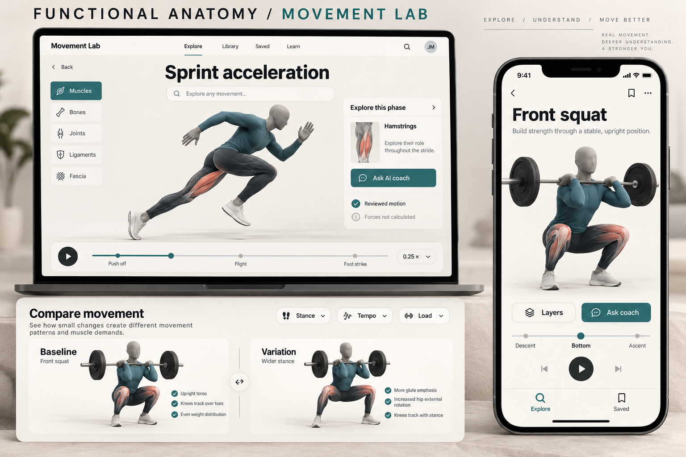

# Functional Anatomy Movement Lab — prototype

A responsive web prototype of the [Movement Lab PRD](docs/PRD.md). It covers the PRD's Stage 1 feasibility pair, **front squat** and **sprint acceleration**, as a full vertical slice: describe a movement, then play, scrub and jump between phases. You can reveal muscles, bones, joints, ligaments and fascia, read phase and structure cards, adjust technique, tempo and load, compare against a baseline, ask a grounded coach, and save the scene.

> **Honesty first.** Every clip and every explanation here is a **draft awaiting expert review**. The app calculates kinematics of a generic body only. Forces, joint moments, muscle activation and tissue strain are shown as **Unavailable**, never as invented numbers.



## Run it

```bash
cd movement-lab
npm install
npm run dev        # http://localhost:5173
npm test           # 32 acceptance/contract tests
npm run build      # typecheck + production build
```

Append `?coach=offline` to the URL to simulate a coach outage (AC-11).

## Try this

1. Type **"wide stance paused front squat 100 lb"** and open it. It resolves as a constrained variation, with parsed parameters and units.
2. Type **"hit"** to get a short clarifying choice. Type **"right-handed baseball swing"** and it is declined honestly with an alternative.
3. In the lab, jump to **Bottom**, pick **Gluteus maximus** in *Find a structure*, then switch *Muscle colour → Length trend*.
4. Go to **Adjust**, set stance width to 52 cm, **Apply**, then **Compare with baseline**.
5. Ask the coach **"How much force is on the knee?"**, then **"How does fascia fit in?"**.
6. **Save** the scene, then reopen it from **Saved**.

## Layout

```
src/
  domain/            pure TypeScript, no DOM: the testable core
    types.ts         PRD §13 data model + multidimensional support status (§10)
    movements.ts     movement definitions, phases, parameter envelopes, planned coverage
    kinematics.ts    generic rig: fixed-foot IK squat, keyed sprint; joint-angle conventions
    rig.ts           structure → rig mapping; musculotendon path length trend
    anatomy.ts       26 draft structure cards across all five layers
    evidence.ts      evidence records (only PRD §21 sources are cited)
    resolver.ts      text → spec; exact / variation / approximation / unsupported / ambiguous
    simulation.ts    validation (no clamping), scene revisions, kinematic outputs, Unavailable outputs
    coach.ts         grounded offline coach + validated structured commands
    storage.ts       local-first saved scenes, favorites, recents, version checks
  viewer/            three.js viewer and shared playback clock
  ui/                React screens: Explore/Library, Lab (inspector tabs), Saved, Learn
docs/
  PRD.md                    product requirements (v1.0)
  IMPLEMENTATION_STATUS.md  requirement-by-requirement traceability and gaps
```

See [docs/IMPLEMENTATION_STATUS.md](docs/IMPLEMENTATION_STATUS.md) for what is done and what is not yet started.
